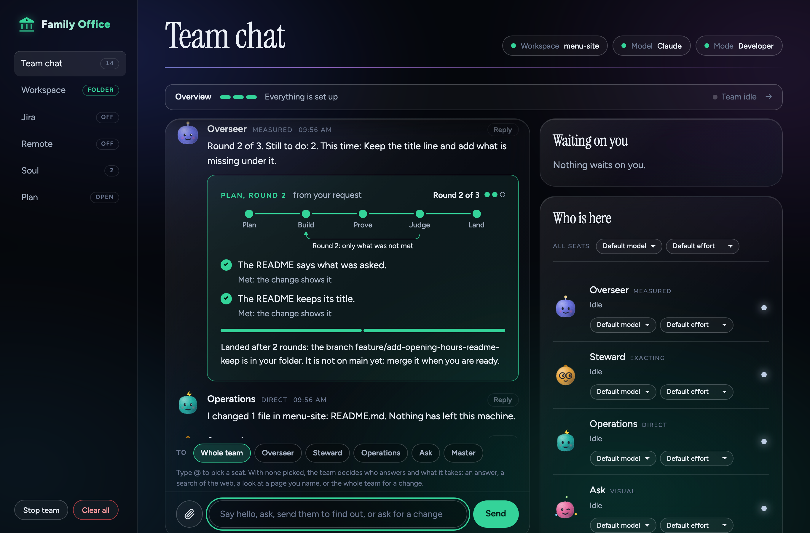

<p align="center">
  
</p>

<h1 align="center">The Crew</h1>

<p align="center">
  A team of five AI agents that plans, builds, proves and lands work, on your own machine.
</p>

<p align="center">
  <a href="#quick-start">Quick start</a> ·
  <a href="#how-it-works">How it works</a> ·
  <a href="#testing">Testing</a> ·
  <a href="docs/architecture.md">Architecture</a> ·
  <a href="docs/training.md">Measurements</a> ·
  <a href="CONTRIBUTING.md">Contributing</a>
</p>

<p align="center">
  
</p>

The Crew is the first product of Family Office. You talk to five agents in one group chat. In **Simple** mode they answer, look
things up and say plainly what they cannot do. In **Developer** mode they work in your repository: they read the request or the
Jira ticket for its requirements, build the change, prove it with a test that fails before and passes after, judge it against
every requirement, and go round again for what is not met.

Everything runs on your computer. There is no account with us and no server of ours: a small local runner listens on
`127.0.0.1`, the team thinks with a model on your machine or with your own Claude Code, and nothing lands in your repository
without the proof you can open and read.

> Family Office is the family of products, and The Crew is the first of them. In the app, in commands and in file names you
> will see the family's name, **Family Office** (`myfamilyoffice.sh`,
> `~/.familyoffice`, the `FO_` settings). The Crew is the name of this app and of this repository.

## Contents

- [Features](#features)
- [Quick start](#quick-start)
- [How it works](#how-it-works)
- [Repository layout](#repository-layout)
- [Testing](#testing)
- [Measured, not claimed](#measured-not-claimed)
- [Publishing](#publishing)
- [Status and limits](#status-and-limits)
- [Documentation](#documentation)
- [Contributing](#contributing)
- [Security](#security)
- [License](#license)

## Features

**The team**

- **Five seats, one chat.** Overseer plans, Steward proves, Operations builds, Ask looks, Master lands. In Simple mode they are
  five people with first names, plain jobs and tastes of their own.
- **Faces that show what is happening.** Each of the five has fourteen expressions (thinking, speaking, pleased, proud,
  unsure, worried, sorry and more), set by what it is doing or has just said: proud because the change landed, worried
  because the answer carries a warning. The same characters and the same faces in both modes.
- **Replies you can act on.** Under a reply, where it bears them out: where the answer came from and a way to have it
  checked, answers to tap, a timer, a sum worked by the app, a day with a calendar file, options side by side, a map link.
  In Developer: commands to copy or run in your workspace, what the team was and was not shown, a proof's runs, and four
  choices on a proven change. All of it is read off the reply by the app, so it is the same on any engine.
- **A memory that is a graph.** What the team keeps is tied together: a lesson to the work it came from, to the files that
  work touched, to its proof, to what you put right about it, to an earlier attempt. Recall lands on what a question names
  and walks two steps out, so a thing that shares no word with the question still comes back when it is tied to one that does.
- **Facts checked by a blank slate.** A fact-checker is a context and a brief. The team opens a slot of its own model with
  nothing in it but the question, so it has not heard the answer; for something you will act on it opens a second whose only
  job is to break the claim. If they do not agree with the answer, the team says so and looks it up.
- **Hindsight that says whether it helps.** Every finished piece of work is kept as what happened: how many rounds, how it
  ended, which lessons were used. A lesson that helps rises and one that does not sinks; what had to be put right is counted
  by kind, and a seat that keeps making one kind of mistake is told the line that prevents it. Ask "how is the team doing?"
  and it answers from those numbers.
- **A team that answers itself.** When one of the five doubts another's answer, the one who gave it takes that up: it looks
  it up, or says the answer again put right, and the first answer is marked as replaced.
- **Two modes, one switch.** Simple is the conversation and nothing else. Developer adds the workspace, Jira, proofs and the
  team's settings. Switching redraws the app in place.
- **It talks the way you do.** The team reads how you write (short or long, casual or formal, your spelling, a hurry, a hard
  day) and answers in kind. In Simple it keeps the manners of a group chat; in Developer it works out whether you are an
  engineer or starting out, and talks to each accordingly.
- **Answers you can take in at a glance.** In Simple mode an answer that suits one becomes a card: steps, a warning, or
  several picks each with its picture (a film's poster, a place), found on Wikipedia and credited there.
- **A memory you can read.** What you decide is kept as a ruling, what the team learns as a lesson, and both are shown to a seat
  before it speaks (Soul, Vision, Hindsight). It is kept in your browser, and you can list it and remove from it.

**Developer mode**

- **A plan from the requirements.** The Overseer reads what must be true when the work is done, from the ticket or from your
  request, as a short list that can be checked.
- **Proof before landing.** The Steward writes a test that fails on the code before the change and passes after it, and hands
  you one picture of the verdict, each check and the steps to repeat it by hand.
- **Rounds until it is met.** Every requirement is judged against the code as it stands. What is not met goes round again, three
  rounds at most, and nothing lands by itself while a requirement is open.
- **Your repository, your way.** A GitHub repository (signed in with GitHub's device flow, no secret of ours) or a Git folder
  already on the machine. A change lands as a pull request, on a branch, or directly, as you chose, or waits for your yes.
- **Jira.** Tickets are read through the Atlassian connector of your own Claude Code: a board, a ticket's text, its pictures and
  its recordings, and "Talk to the team" on any ticket.

**Running it**

- **Three ways to think.** A local model set up for you (TensorFold on Apple silicon, then Strata, then llama.cpp), Claude Code
  already on the machine with your own sign-in, or a model server that is already running (Ollama, LM Studio, llama.cpp, vLLM)
  here or on another machine over SSH.
- **Honest about the engine.** On Claude Code a green proof reads "Proven". On a local model, which writes both the change and
  its checks, it reads "Checked, not proven" and always waits for you. That line was drawn from [measurements](docs/training.md).
- **Local by construction.** The runner listens on loopback only, serves the pages itself so that no other website can drive it,
  and stops when the last page is closed.
- **On your phone, if you want it.** Remote pairs your own Android phone with the app on your computer by a code; it is off until
  you switch it on.
- **No dependencies, no build step.** Plain HTML, CSS and ES modules in the browser; Node's standard library in the runner.

## Quick start

You need [Node.js](https://nodejs.org/) 18 or newer. Nothing is installed by cloning or starting.

```bash
git clone https://github.com/nseidm1/The-Crew.git
cd The-Crew
npm start
```

Open <http://127.0.0.1:5210/> and press **Start**. Start measures the machine, offers the engines it can run, lists exactly what
it would install, and installs nothing until you press the button that says so.

| To think with | You need |
|---|---|
| Claude Code | The `claude` command on the machine. Start can install it and walk you through its own sign-in. |
| A local model | An Apple silicon Mac for the first choice (TensorFold). The agent that edits files needs Node.js 22.19 or newer; the runner finds one or fetches a private copy. |
| A model already running | Its address, or nothing at all if it is on this machine on a usual port. |

Useful while developing:

```bash
PORT=6000 npm start          # another port
FO_KEEP=1 npm start          # do not stop when the last page closes
npm run bundle               # write dist/, the folder that gets published
npm run gateway              # serve dist/ as a hosted site would, on http://localhost:5300/
npm run format               # format the code with Prettier (after `npm install`)
```

## How it works

```
  browser                          your machine                         outside
 ┌──────────────────────┐        ┌────────────────────────────┐
 │ pages  (src/*.html)  │  HTTP  │ runner  (src/runner/)      │──▶ a local model server
 │ team core            │◀──────▶│  127.0.0.1 only            │──▶ Claude Code (your sign-in)
 │  (src/js/            │  same  │  measures, installs, runs  │──▶ git, gh, adb, ssh
 │   team-core.js)      │ origin │  the engine and the agent  │
 │ the chat, the plan,  │        │  clones, builds, proves,   │──▶ GitHub, Jira (through your
 │ the proofs, the soul │        │  lands                     │    own accounts)
 └──────────────────────┘        └────────────────────────────┘
```

1. **The pages** are static files. The team's record (chat, work, proofs, lessons) and the round of the table live in the
   page, in `src/js/team-core.js`, and are kept in the browser.
2. **The runner** is one Node process with no dependencies. It is the only part that touches the machine: it measures it,
   sets up an engine, runs the agent, works in a clone of your repository, and proves and lands changes.
3. **A change** goes: requirements → build → proof (red on the old code, green on the new) → judgement of each requirement →
   another round for what is left, or landing.
4. **Publishing** makes one folder, `dist/`, that holds the pages, the runner and a manifest of every file's SHA-256. The
   launcher fetches by that list and refuses anything that does not match it.

[docs/architecture.md](docs/architecture.md) has the whole picture: every module, where state lives, and what the runner
will and will not answer.

## Repository layout

```
src/            the app as it ships, in the layout it ships in
  *.html          the pages: landing, Start, the app, the films, the owner's panel
  css/  js/       styles and browser modules (no framework, no build step); js/team/ is the team's core, part by part
  runner/         the local runner: one module for each thing it does; runner/setup/ is each way a team is set up
  server.mjs      serves the pages and hands /api/ to the runner
  myfamilyoffice.sh, myfamilyoffice.mjs    the one-command installer and launcher
  android/        the Android app's source and its build script
tools/          what a publisher runs: bundle, gateway, access codes, the landing page's readings
tests/          the checks: the chat core, the runner, the app in a browser, the landing page
  fakes/          stand-ins for outside programs (Claude Code, gh, adb, ssh, model engines)
training/       the team measured on real work: scenarios, scripts and results
docs/           architecture, development, publishing, measurements
assets/         the brand marks and the promo poster
```

## Testing

```bash
npm test                 # the chat core and the runner: no browser, nothing installed, nothing fetched
```

The browser checks drive the real pages and the real runner in Chromium, with stand-ins for every outside program, so nothing
real is installed, signed in to or changed:

```bash
npm install              # the two development dependencies: Playwright and Prettier
npx playwright install chromium
npm run test:browser     # the app
npm run test:landing     # the landing page and its film
npm run test:all         # everything, one after another
```

| Suite | What it drives | Checks |
|---|---|---|
| `tests/core/` | The team core in Node, with a stand-in engine | 180 |
| `tests/runner/` | The whole runner over HTTP, with stand-ins for every program it starts; the installer's banner in real terminals | 555 |
| `tests/browser/` | The app in Chromium at computer and phone sizes, and a crawl of every page | 214, and the crawl |
| `tests/landing/` | The landing page: layout, the film frame by frame | 29, and two measurements |

[tests/README.md](tests/README.md) lists every check and what it covers.

## Measured, not claimed

The team is measured on real work by the scripts in [`training/`](training/): a small repository, a ticket written the way a
real one is, and a hidden check the team never sees. The team's own proof says "proven"; the hidden check says whether that was
true. A proof that is green over a wrong change is the failure that matters, and it is counted separately.

| Suite (13 Nov 2026) | Claude Code, Sonnet 5.5 | Local model, Nemotron 3.5 30B |
|---|---|---|
| Harder tickets (17) | 17 right, no false green | 3 right, 2 false green |
| Earlier tickets (27) | 24 right, no false green | 12 right of 21 run, no false green |
| Plan and loop (3 JavaScript tickets) | 3 landed right in one round | not run |

Those two false greens are why a local model's green proof is shown as "Checked, not proven" and never lands by itself.
[docs/training.md](docs/training.md) has every suite, what each pass changed in the product, and what has not been measured.

## Publishing

`npm run bundle` writes `dist/`: the pages, the runner, the launcher and `manifest.json`. That one folder is what gets pinned
to IPFS or handed to any static host, and it is refused if a page reaches for a root-absolute path, so it works at the root of
an address and under a subpath alike. Someone who opens the published site gets one command:

```bash
curl -fsSL https://myfamilyoffice.eth.limo/myfamilyoffice.sh | sh -s https://myfamilyoffice.eth.limo/
```

It finds Node.js or fetches a private copy, fetches the app by the manifest, checks every file against it, and starts the app on
`127.0.0.1`. [docs/publishing.md](docs/publishing.md) covers the bundle, the stand-in gateway, the owner's panel, plans and
access codes, and the Android app.

## Status and limits

This is a first release, built and measured on one machine (an Apple M2 Ultra). Said plainly:

- **macOS on Apple silicon first.** The other engines exist so that other machines can run a team, and are covered by
  stand-ins in the tests, not by runs on that hardware.
- **Chromium only** in the browser checks. Other browsers and a real phone have not been checked.
- **Remote** (the team on your own Android phone, paired by a code) has been checked against stand-ins, not on a real
  phone. A publisher can switch it off for a version (`src/js/product.js`).
- **Paying and publishing** (a plan bought on Base, a bundle pinned and a name pointed at it) have run only against stand-ins.
- **The loop's second round** has been seen working with a stand-in only: every real run so far landed in one round.
- **Some modules are still large.** The code is formatted with Prettier and its two largest functions have been divided into
  parts, but the app's views, the proof and the runner's routes are each several thousand lines. See
  [CONTRIBUTING.md](CONTRIBUTING.md#conventions) for the conventions and where the code does not yet meet them.

## Documentation

| | |
|---|---|
| [docs/architecture.md](docs/architecture.md) | The parts, every module, where state lives, the runner's rules |
| [docs/development.md](docs/development.md) | Running from source, settings, writing a check |
| [docs/publishing.md](docs/publishing.md) | The bundle, the launcher, the owner's panel, plans, the Android app |
| [docs/training.md](docs/training.md) | The measurements and how to run them |
| [tests/README.md](tests/README.md) | Every check and what it covers |

## Contributing

Issues and pull requests are welcome. [CONTRIBUTING.md](CONTRIBUTING.md) says how to set up, the conventions the code follows,
and what a change has to come with.

## Security

Please report a vulnerability privately, not in a public issue. [SECURITY.md](SECURITY.md) says how, and describes what the
runner is built to refuse.

## License

The Crew is licensed under the [Apache License, Version 2.0](LICENSE). [NOTICE](NOTICE) carries the attributions that travel
with it.

The fonts in `src/css/fonts/` (Figtree, Nunito, Instrument Serif, Martian Mono) are under the SIL Open Font License 1.1; each
license is beside its font.
